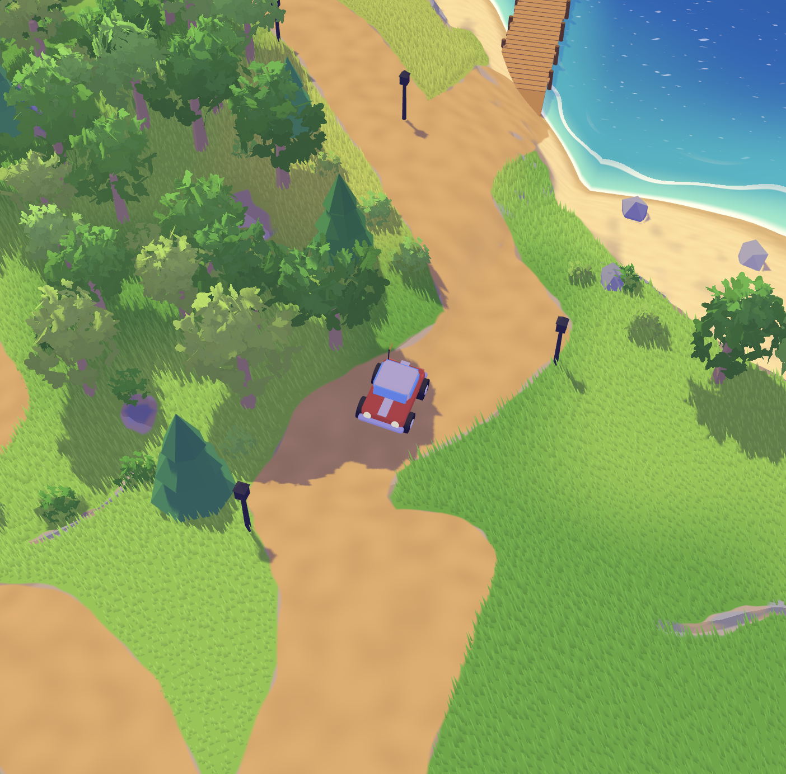
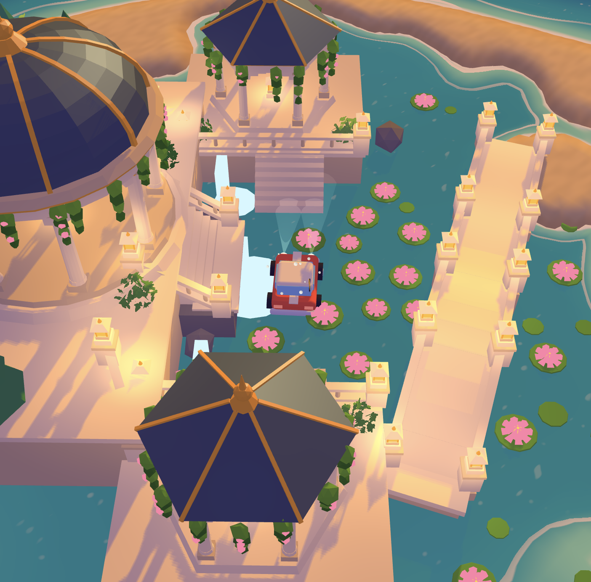
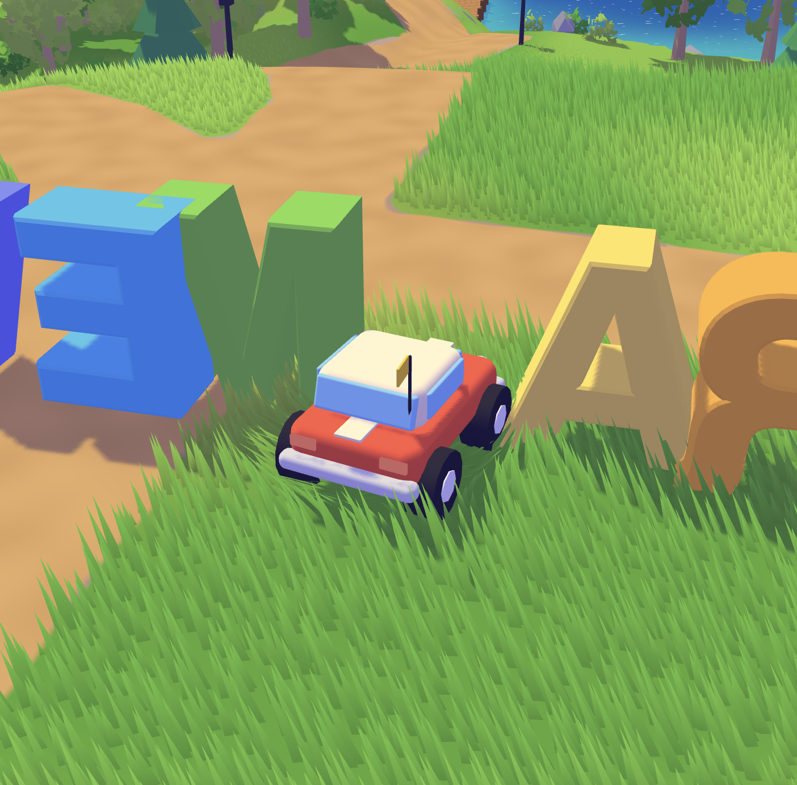
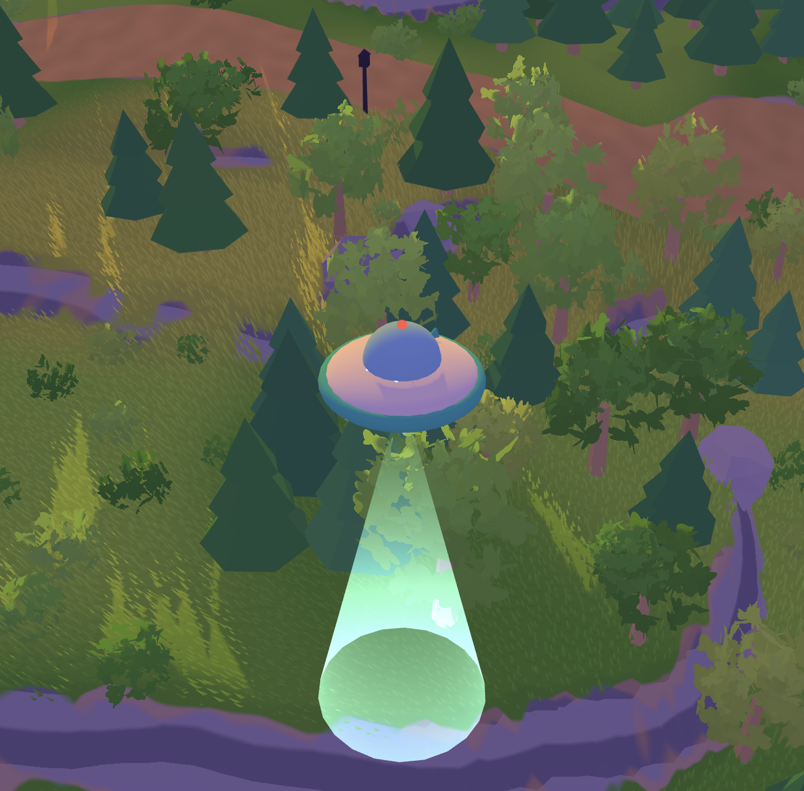
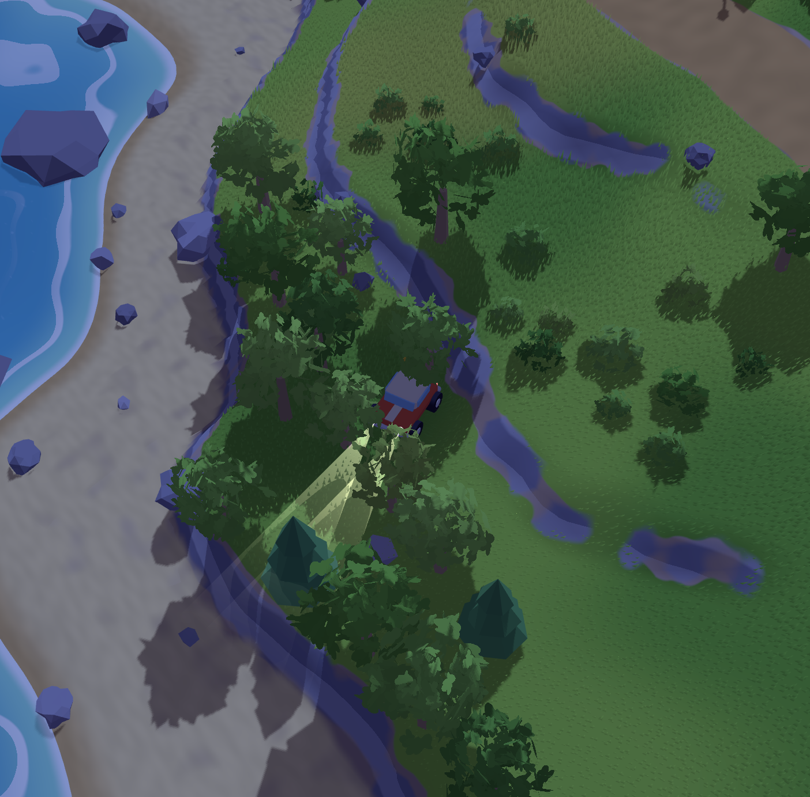
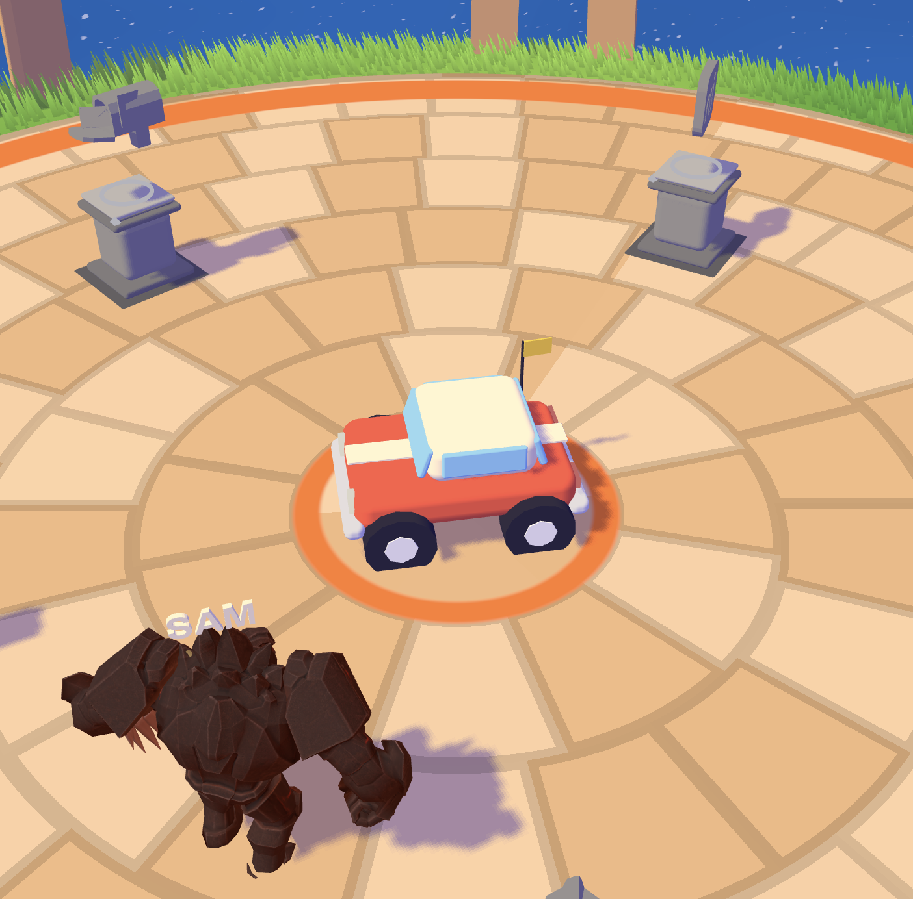
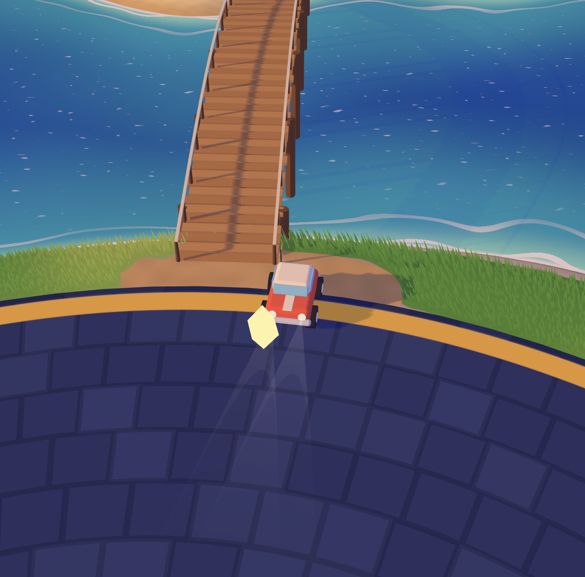
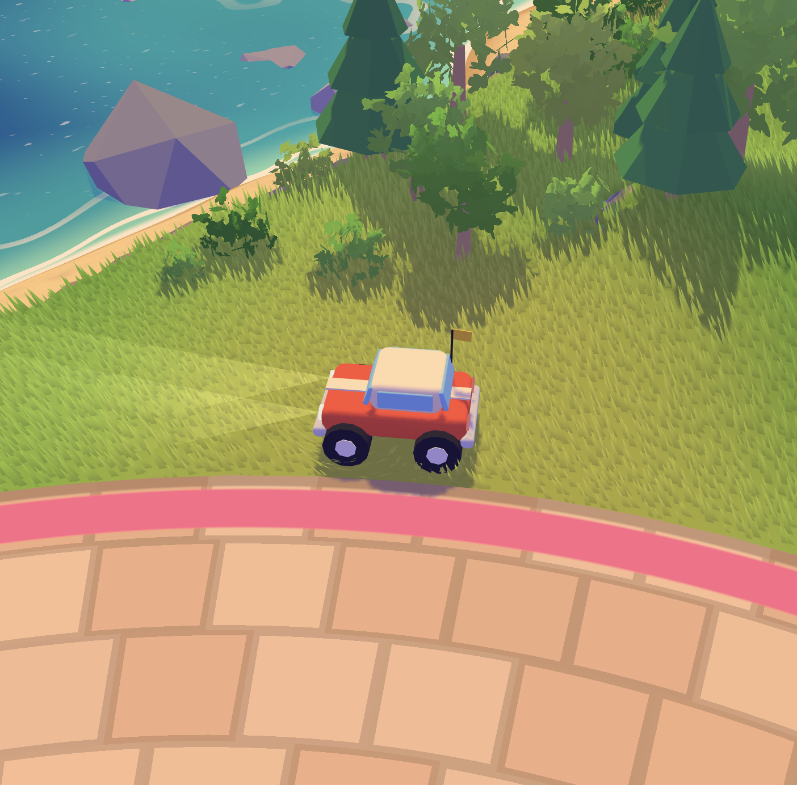

# Hi everyone — I made a cool website!

**Tatsat's Resume** is a playable 3D island portfolio. Drive, fly, wander into halls, talk to a golem, open my projects, and mess with the vehicles.

Inspired by [Bruno Simon](https://bruno-simon.com). Built with Three.js, Vite, a lot of AI help, and too many late nights.

**Live:** hosted on **Cloudflare Pages** (custom domain connected from Squarespace).  
**Play locally:** `npm install` → `npm run dev`

<p>
  
  
</p>
<p>
  
  
</p>
<p>
  
  
</p>
<p>
  
  
</p>

---

## What's in the world

### The island
- Stylized terrain, roads, docks, lighthouse, bridges, grass, water, and a day → dusk → night → dawn cycle
- Giant knockable letters that spell **FRAMEWORK** near spawn
- Colored landmarks on the minimap so you always know where you are
- Speed chip, arrival toasts, dialogue prompts, and an Island Menu with controls + music

### Checkpoints
| Key | Place | What happens |
|-----|--------|--------------|
| `1` | **Stone Circle** | Meet **Sam** the golem. Open LinkedIn, Instagram, GitHub, the blog, and email from the pedestals. |
| `2` | **Temple of Tribulations** | Enter the Research Sanctuary. Walk the hall and open project statues. |
| `3` | **Market Row** | Enter the retro arcade. Play cabinets, chase high scores. |
| `4` | **Lotus Garden** | Scenic lagoon, bridge, and lanterns — pure vibes. |
| `0` | **Home** | Warp back to spawn. |

### Vehicles (`V` to cycle)
- **Kart** — the main ride. Boost with Shift, jump with Space, respawn with `R`.
- **UFO** — full air mode: mouse look, sonic boom, somersault, loop, and a light beam.

### Mobile (Bruno Simon–style)
On touch devices: left **joystick** steers, right buttons **boost / accelerate / brake / jump**, plus **V** (swap ride) and **E** (interact).

### Research Sanctuary (Temple)
Enter on the temple pad with **E** / toast click. Leave with **Esc**.

Project statues inside:
- PJM Electricity · AI Power Demand
- Stock Market & Startup Success
- Pokémon Reinforcement Learning Model
- Flo the Autonomous Helper Robot
- DDC Taxi Driver · Bellman Equation

### Market Row Arcade
A Bruno-Simon-palette retro hall with playable cabinets (high scores saved in the browser):

| Cabinet | Game | Vibe |
|---------|------|------|
| Astro | **ASTRO BLASTER** | Space invaders — move + shoot |
| Brick | **BRICK SMASH** | Breakout paddle |
| Racer | **TURBO DRIFT** | Lane racer + nitro |
| Hopper | **PIXEL HOPPER** | Runner with double jump + gems |

Claw machines and air hockey are décor for now. More cabinets later.

### Music player
Island playlist loops from the menu (Epidemic Sound tracks):

1. Balderdash — Martin Klem
2. Solitude — DonVayei
3. Tiny Pockets — The Fly Guy Five

Controls: ▶ / ⏸ · ⏹ · ↻ · ⏭ — centered in the Island Menu. Music starts when you hit **Start the engine**.

### Sam + socials
Sam protects the links at Stone Circle. Talk with **E**. Pedestals open:
- [LinkedIn](https://www.linkedin.com/in/tatsat-upadhyay)
- [Instagram](https://www.instagram.com/pplcallmetat/)
- [GitHub](https://github.com/Tatsat454)
- [The Next Framework (blog)](https://thenextframework.blog/)
- Email

---

## Controls

### Everywhere
| Input | Action |
|-------|--------|
| Enter / Start | Begin the island + music |
| `V` | Cycle Kart → UFO |
| `C` | Chase camera |
| `T` / Day chip | Skip day / night phase |
| `E` / Click | Talk, enter halls, open links |
| `Esc` | Close menu / leave hall / leave cabinet |
| `1`–`4` / `0` | Travel to areas / home |

### Land (Kart)
| Input | Action |
|-------|--------|
| `W` `A` `S` `D` | Drive |
| Shift | Boost |
| Space | Jump |
| `R` | Respawn |
| Mouse drag | Orbit camera |
| Touch stick / buttons | Mobile drive (phone / tablet) |

### Air (UFO)
| Input | Action |
|-------|--------|
| Mouse | Look / steer |
| `W` / `S` | Fly forward / descend |
| `A` `D` | Yaw |
| Space / Ctrl | Pitch up / down |
| Shift | Sonic boom |
| `Q` / `F` | Somersault / loop |
| `L` | Light beam |

### Halls
WASD walk · Shift sprint · Space jump · Esc leave

---

## Dev diary

A rough log of how this island grew. Dates follow the git timeline.

### Act 0 — Publish the playground
Shipped the first playable island on Netlify: terrain, kart, day cycle, and the “just drive around” loop. The goal was simple — a resume you can *play*, not scroll.

### Act 1 — Camera wars & UFO
Kart camera got click-drag orbit so looking around felt intentional. Then the **UFO** landed: mouse look, aerial physics, sonic boom, loops — a whole second control language on the same island.

### Act 2 — Voice & identity
Rewrote the intro as **Tatsat's Resume · Life · Inspos**. Credits moved off the splash so the first screen was brand-first. Added README screenshots and a public roadmap (music, Zeus cloud, portal, minigames, polish).

### Act 3 — Temple of Tribulations
Built the first real interior. Drive to the golden landmark, step into the **Research Sanctuary** as a walking human, and browse research statues with their own lighting. Outside, **Lotus Garden** got a lagoon and lantern pass so the island had a quiet corner, not only destinations.

### Act 4 — Market Row Arcade
Added a pink Market Row landmark and a full retro arcade hall (GLB interior + exterior). Four playable minigames with local high scores. Palette and vibe nodding hard at Bruno Simon. Cabinets zoom when you play; Esc brings you home to the island.

### Act 5 — Soundtrack + menu + mobile
- Built an **Island Menu** with Land/Air controls, How to Play, and a music bar
- Shipped the **playlist** with ▶⏸⏹↻⏭ symbols, centered UI
- Added **Bruno Simon–style mobile controls** (joystick + drive buttons)
- Connected a **custom domain**: Squarespace registration → Cloudflare nameservers → Cloudflare Pages hosting

Music and minigames graduated from “coming soon” to “in the world.”

---

## Coming soon

### Zeus lightning cloud
Drive into a storm. Camera shifts — you become Zeus — and you blast the island with lightning.

### Space portal
Cross into a vibey universe that reacts to the music — part flight, part visualizer.

### Arcade expansion
Turn claw machines / air hockey into real games. More cabinets, more chaos.

### Polish pass
Upgrade older assets, tighten collisions, and keep the island feeling handmade.

---

## Stack

- **Three.js** + Vite
- Vanilla ES modules (`src/main.js`, `src/world/*`)
- GLB / FBX props under `public/`
- Deploy: **Cloudflare Pages** (`npm run build` → `dist`)
- Playlist files live in `public/music/`

```bash
npm install
npm run dev      # local
npm run build    # production → dist/
```

---

## Credits

- Island concept & vibe inspired by [Bruno Simon](https://bruno-simon.com)
- Social sculptures by Bruno Simon (MIT) — see `public/bruno/LICENSE`
- Music via Epidemic Sound (see `public/music/`)
- Almost every asset shaped with AI help — then wired, tuned, and broken until it felt right

Made by [Tatsat](https://github.com/Tatsat454). Have fun, find the bugs, say hi.
